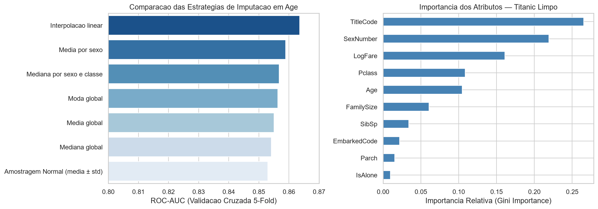
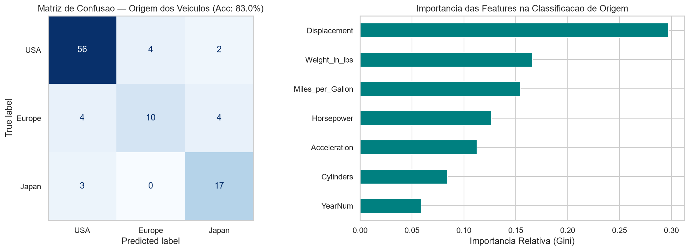
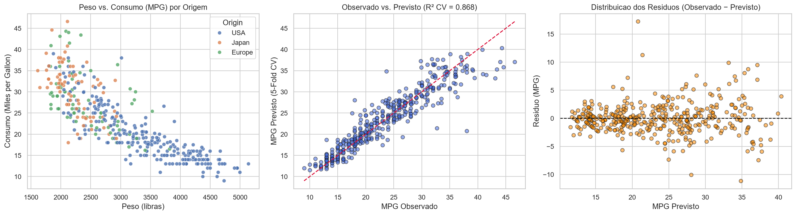
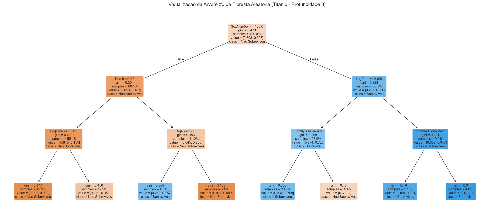
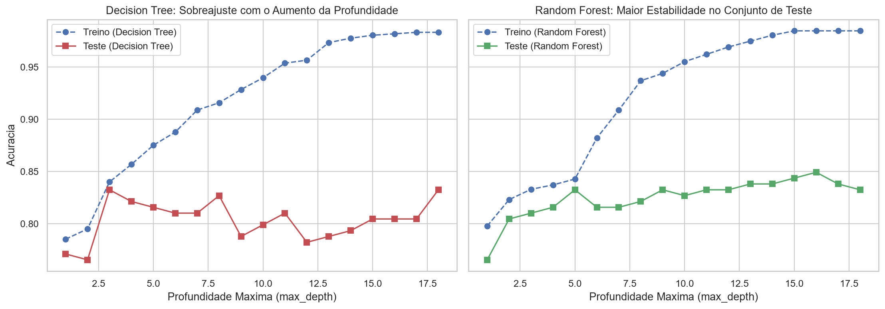

# Random Forest e Métodos Ensemble: Titanic e Vega Datasets

Exploração prática de modelos supervisionados baseados em árvores de decisão e métodos *ensemble* (`RandomForestClassifier`, `RandomForestRegressor`, `Bagging`, `AdaBoost`, `Stacking` e `Voting`) com `scikit-learn` sobre os conjuntos de dados **Iris**, **Titanic** (Kaggle) e **Cars** (`vega_datasets`).

## Integrantes

- Cesar Gritti — GitHub: Ce-22
- Patrick Barreira — GitHub: PatrickBarreira0

## Como executar

Requer Python 3.11 ou superior. Instale as dependências com `pip install -r requirements.txt` e execute `lab_random_forest_titanic_vega.ipynb` do início ao fim. Os arquivos `titanic/train.csv`, `titanic/test.csv` e `titanic/gender_submission.csv` preservam uma cópia local dos dados da competição do Kaggle, permitindo repetir toda a análise sem depender de autenticação ou rede.

## Principais resultados

- **Simulação de sobrevivência no Titanic (Item 1):** Para o perfil testado (**Cesar Gritti — 21 anos, sexo masculino, 2ª classe**), o modelo estima baixa probabilidade de sobrevivência (**0,7%** na árvore sem restrição de profundidade e **8,2%** no modelo limpo e regularizado), prevendo não sobrevivência (`0`) em função da prioridade histórica de evacuação dada a mulheres e crianças e aos passageiros da 1ª classe.
- **Imputação estatística da idade (Item 2):** Entre as 7 abordagens testadas em validação cruzada estratificada de 5 pastas (`média`, `mediana`, `moda`, `média por sexo`, `mediana por sexo e classe`, `interpolação linear` e `amostragem normal` $\mu \pm \sigma$), a **mediana por sexo e classe** atingiu a maior acurácia (**0,8182** e F1 de **0,7461**), enquanto a **interpolação linear** obteve o maior ROC-AUC (**0,8635**).
- **Limpeza avançada e engenharia de atributos no Titanic (Itens 3 e 4):** Corrigir a distorção das idades de bebês (`Age < 1`) e incorporar título social (`Title`), estrutura familiar (`FamilySize`, `IsAlone`), tarifa em escala logarítmica (`LogFare`) e porto de embarque (`Embarked`) elevou a acurácia em validação cruzada de **0,8070** para **0,8339** (ROC-AUC de **0,8594** para **0,8766**), alcançou **0,8212** (ROC-AUC de **0,8598**) no conjunto holdout de teste e **0,9067** de concordância frente ao baseline `gender_submission.csv` nos 418 passageiros de `titanic/test.csv`.
- **Classificação multiclasse no Vega Dataset `cars` (Item 5):** O `RandomForestClassifier` previu a região de origem dos veículos (`USA`, `Europe`, `Japan`) com acurácia de **0,8300** no conjunto de teste (F1 de **0,90** para `USA`, **0,79** para `Japan` e **0,62** para `Europe`), tendo a cilindrada (`Displacement`) e o peso (`Weight_in_lbs`) como atributos mais discriminativos.
- **Regressão no Vega Dataset `cars` (Itens 7 e 8):** O `RandomForestRegressor` explicou a eficiência energética (`Miles_per_Gallon`) com $R^2$ de **0,8994** (RMSE de **2,39 MPG** e MAE de **1,68 MPG**) no conjunto de teste e $R^2$ de **0,8678** (RMSE de **2,84 MPG**) em validação cruzada de 5 pastas.
- **Decision Tree vs. Random Forest (Itens 9 e 10):** O experimento variando `max_depth` de 1 a 18 demonstrou que uma Árvore de Decisão isolada sofre forte sobreajuste (*overfitting*) conforme a profundidade cresce, enquanto o Random Forest estabiliza a variância no conjunto de teste por meio da agregação *bootstrap* e seleção aleatória de atributos.

## Limitações

Os dados históricos do Titanic refletem regras sociais e operacionais específicas de um único evento marítimo de 1912 e apresentam 77% de ausência na variável `Cabin` e ~20% em `Age`. No conjunto `titanic/test.csv` da competição oficial do Kaggle, os rótulos verdadeiros não são distribuídos no CSV público, de modo que a verificação direta com `gender_submission.csv` mede a concordância com a hipótese de referência por gênero, razão pela qual complementamos a análise com avaliação *out-of-fold* (`StratifiedKFold`) e *holdout* estratificado. No dataset `cars` do `vega_datasets`, a amostra cobre modelos comercializados entre 1970 e 1982, com predominância de veículos norte-americanos (62%), o que desbalanceia as classes minoritárias (`Europe` e `Japan`).

## Fontes

- Kaggle Competition — *Titanic: Machine Learning from Disaster*: https://www.kaggle.com/c/titanic/data
- Vega Datasets (`cars` e `iris`): https://github.com/vega/vega-datasets
- Scikit-Learn Documentation — *Ensemble methods (`RandomForestClassifier`, `RandomForestRegressor`, `Bagging`, `AdaBoost`, `Stacking`, `Voting`)*: https://scikit-learn.org/stable/modules/ensemble.html
- James, G., Witten, D., Hastie, T., Tibshirani, R., & Taylor, J. (2023). *An Introduction to Statistical Learning with Applications in Python (ISLP)*: https://www.statlearning.com/
